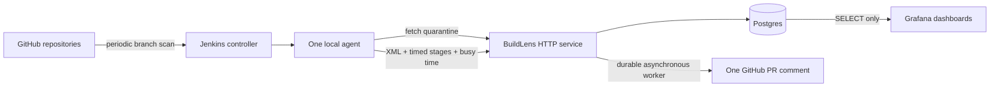

# BuildLens

**Explain a Jenkins failure. Keep known flaky tests visible. Surface slow builds.**

BuildLens is a local CI intelligence service written in Go for Jenkins and Maven.
An agent CLI uploads test results, stage timings and measured agent busy time.
The service attributes infrastructure failures, detects flaky tests, maintains a
bounded quarantine list, evaluates duration regressions and updates one PR comment.

[Measured results](docs/results.md) · [Run evidence](docs/evidence/P5/README.md) ·
[Architecture and plan](docs/plan.md) · [Study notes](docs/study/) · [Decisions](docs/adr/)

## What it does

| Capability | Behavior |
| --- | --- |
| Infrastructure attribution | Matches agent loss, OOM, disk full, Docker and dependency-network failures before evaluating flakiness |
| Flaky detection | Surefire rerun recovery, opposite outcomes on the same tested content, and default-branch outcome flips |
| Quarantine | Excludes selected methods from blocking tests, runs them visibly in a non-blocking stage, and releases after consecutive passes |
| Duration checks | Median/MAD baselines, minimum samples, sustained-change and PR-jump rules, with stored evidence |
| PR summary | One durable sticky comment with quarantine, regression and reference-cost sections |
| Reference cost | Uses explicitly measured agent busy time; missing timing or price remains unknown |
| Grafana | Four dashboards provisioned from files with a SELECT-only Postgres account |

This is a local demonstration. Lab flakiness and controlled slowdowns are
**injected**. It does not establish production precision, throughput, uptime or
real AWS spend. The IDoFT ground-truth benchmark, AWS phase and read-only MCP
interface are later work, not current capabilities.

## Architecture



One Go module, one HTTP service and one agent CLI. HTTP uses `net/http`; Postgres
queries are generated with sqlc, migrations run through goose, and structured
logs use `log/slog`. There is no Kafka, ML model or web framework.

## Run locally

Prerequisites: Windows PowerShell 7.4+, Docker Desktop with Linux containers,
Git, Go 1.27.1 and golangci-lint 2.14.0 for host lint checks. The Maven wrapper
uses an available JDK 21. Container images and plugins are pinned in their source
files; [the study notes](docs/study/P1-design.md) record the original sources.

```powershell
Copy-Item .env.example .env
notepad .env
# Set unique local passwords and BUILDLENS_INGEST_KEY.
# Set GITHUB_USERNAME/GITHUB_TOKEN for read-only access to the two repositories.
./tasks.ps1 up
```

`up` builds images sequentially, applies migrations, provisions the Grafana reader
and loads Jenkins/Grafana configuration from files. If the Grafana reader password
is empty, it is generated into the ignored `.env`. There are no UI setup steps.
Keep `.env` private. Do not commit tokens, passwords, dumps or private raw consoles.

| Service | Local address | Login |
| --- | --- | --- |
| Jenkins | http://localhost:8080 | JENKINS_ADMIN_USER / JENKINS_ADMIN_PASSWORD |
| BuildLens health | http://localhost:8091/healthz | Health only; build/quarantine APIs require the ingest key |
| Grafana | http://localhost:3001 | GRAFANA_ADMIN_USER / GRAFANA_ADMIN_PASSWORD |
| Postgres | localhost:5433 | POSTGRES_USER / POSTGRES_PASSWORD |

Configured memory limits total **3392 MiB**, separate from measured usage.
The trusted local Jenkins agent has the Docker socket for integration tests;
this grants host-equivalent control. Do not run untrusted jobs on it. Fork
discovery is disabled. The temporary Go-check runner is limited to 1536 MiB and
its test Postgres to 384 MiB; run those checks outside the measured lab batch.

## Build runner and dashboards

After explicit owner authorization, create the local Jenkins API token:

```powershell
./tasks.ps1 driver-token
./tasks.ps1 drive 50
# Optional explicit folder/job and build parameters:
./tasks.ps1 drive 2 'buildlens-lab/PR-1' 'SLOW_MILLIS=10000'
./tasks.ps1 grafana
```

The default job is `buildlens-lab/main`. The [measurement record](docs/results.md)
states the actual job/source used for its batch; a fresh run is not expected to
reproduce identical durations. PR builds can publish comments when the separate
BuildLens token is configured, so run them only when publication is intended.
The runner follows queue IDs rather than guessing the next build number, waits
sequentially, stops on failure/missing upload, and preserves checkpoints/consoles
under ignored `notes/experiments/`. It samples memory during the run. An explicit
`-UsePassword` fallback uses the existing local login plus a CSRF cookie session.

Grafana → **Dashboards → BuildLens**:

- **Flaky tests:** current quarantine, activation/release events and rule evidence.
- **Duration regressions:** stored measured values, baseline median and threshold.
- **Reference cost:** known local equivalent cost, unknown builds, branches and a
  duration-weighted stage allocation. This is not metered stage billing.
- **Build health:** build results/day, infrastructure reasons and recent builds.

Edit SQL under `grafana/queries/`, then run `./tasks.ps1 dashboards` to regenerate,
provision and execute every panel/variable query. Dashboard/datasource UI edits
are disabled. Empty infrastructure-reason tables can legitimately mean no events.

## PR comments

Use a separate fine-grained `BUILDLENS_GITHUB_TOKEN` with Metadata read and Pull
requests read/write on `nibinrj/buildlens-lab`, and restrict
`BUILDLENS_GITHUB_REPOSITORIES` accordingly. Keep Jenkins's GitHub token read-only.
An empty BuildLens token disables publication. The worker persists desired/sent
generations, leases and retry timing; GitHub failures do not roll back ingest.
The [live PR evidence](docs/evidence/P4/live-20261019/README.md) records one real
comment updated across two successful builds. Read-only Jenkins commit-status
HTTP 403 warnings are expected and separate from comment delivery.

## Verify changes

```powershell
./tasks.ps1 lint
./tasks.ps1 test
./tasks.ps1 dogfood-local
```

`test` includes driver failure paths, memory parsing, Go race tests with real
Postgres, parser fixtures and Jenkins shared-library/pipeline tests. The new root
Jenkinsfile runs static builds, formatting/vet/lint/race checks and library tests
through the same shared library. Its normal GitHub multibranch execution requires
the owner to commit and push it. `dogfood-local` is a labelled, hashed local
adapter for reviewing that pipeline before publication; it is not evidence that
GitHub served an uncommitted file.

## Demo backup and restore

```powershell
./tasks.ps1 demo-dump
./tasks.ps1 demo-restore backups/buildlens-YYYYMMDD-HHMMSS.dump
```

The default restore creates a **new isolated database**, validates the archive
and preserves live data. Dumps and checksum manifests stay under ignored
`backups/`. To replace the active demo, the owner explicitly selects
`./tasks.ps1 demo-restore <dump-path> -ReplaceLive` and confirms the named database.
That path pauses writers, restores transactionally, clears operational comment
work to avoid replaying historical external writes, reapplies Grafana grants and
restarts the services. Replacement is distinct from the isolated restore test.
`./tasks.ps1 down` keeps all named volumes.

## Limits and prior art

- Isolated quarantine passes do not prove an order-dependent test is fixed.
- Short tests can alert on local timing variation; snapshot-copy and network
  checkout baselines describe different work. Thresholds have not been tuned
  into a production precision claim.
- Reference cost excludes idle capacity, storage, network and CPU credit charges.
  Multi-allocation accounting and actual AWS pricing/billing are not verified.
- The service is local and single-agent; authentication uses shared ingest and
  narrowly scoped GitHub credentials. There is no public hosted deployment.
- Naturally occurring flaky-test accuracy, sustained-load performance and the
  later MCP workflow require their own evidence. See [results](docs/results.md).

Prior art includes [Jenkins Flaky Test Handler](https://plugins.jenkins.io/flaky-test-handler/)
and [CloudBees Smart Tests](https://docs.cloudbees.com/docs/cloudbees-smart-tests/latest/).
BuildLens is a learning implementation with explicit deterministic rules and a
reproducible local lab; no feature-equivalence or benchmark-superiority claim is made.
